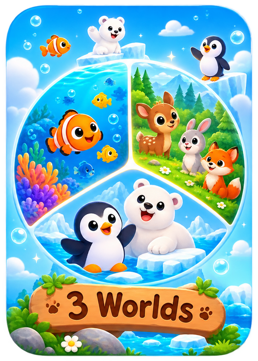

# 🍉 SUIKA

**A cute animal-merging puzzle game with three worlds.**
Drop the little animals, merge the matching ones, and grow the biggest one of all!

*Plays in your browser · installs like an app · works offline*

---

## 🎮 What is SUIKA?

SUIKA is a relaxing physics puzzle in the style of the "Suika Game". Animals fall into a jar, and when **two identical animals touch, they merge into the next, bigger animal**. Keep merging to reach the final animal of each world, and try not to let the pile reach the red line!

There are **3 worlds** to play, each with **9 animals** (27 in total), its own scenery, its own relaxing music and its own high score.

| World | Evolution chain (smallest → biggest) |
| --- | --- |
| 🐋 **Ocean** | Starfish → Sea Urchin → Clownfish → Tropical Fish → Pufferfish → Jellyfish → Octopus → Sea Turtle → **Whale** |
| 🐼 **Forest** | Ladybug → Chick → Bunny → Hedgehog → Kitty → Puppy → Sloth → Penguin → **Panda** |
| 🐻‍❄️ **Arctic** | Seal Pup → Puffin → Snowy Owl → Arctic Fox → Reindeer → Walrus → Orca → Blue Whale → **Polar Bear** |

## 🕹️ How to play

1. **Move** the animal at the top left and right.
2. **Drop** it into the jar.
3. When two **identical** animals touch, they **merge** into the next one in the chain.
4. Watch the **"Next"** preview in the corner to plan your move.
5. If the pile stays above the **red dashed line** for a moment, it's **game over**.

### Controls

| Action | Mouse / Touch | Keyboard |
| --- | --- | --- |
| Move | Move the mouse / drag your finger | `←` `→` |
| Drop | Click / tap | `Space` or `Enter` |
| Pause | ⏸️ button | `P` |

## ✨ Features

- 🌊🌲❄️ **Three themed worlds**, each with its own background, colours and music
- 🐾 **27 adorable animals**, each in a round bubble that matches its physics body
- 🔗 **Combos**: chain merges quickly for bonus points
- 🏆 **Best score for every world**, saved on your device
- 🎵 **Relaxing music and sound effects**, generated live in the browser (no audio files), each with its own on/off button
- ⏸️ **Pause**, restart and change world at any time
- 📲 **Installable PWA**: add it to your home screen and play it fullscreen like a native app
- ✈️ **Works offline** after the first visit
- 📱 **Responsive**: phones, tablets and desktop, with the board always keeping the right proportions

### Scoring

- Every merge scores more the bigger the new animal is.
- Merging again within a short time starts a **combo** and adds bonus points.
- When two of the biggest animals meet, there is a celebration and a bonus. 🎉

## 📲 Install it as an app

- **Android (Chrome):** menu `⋮` → **Install app** (or **Add to Home screen**)
- **iPhone / iPad (Safari):** **Share** → **Add to Home Screen**
- **Desktop (Chrome / Edge):** click the install icon in the address bar

## 🚀 Deploy on Vercel (via GitHub)

This is a plain static site: **no build step, no dependencies.**

1. Upload the **files** of this folder to a GitHub repository. `index.html` must be in the **root** of the repo, not inside a subfolder.
2. In Vercel choose **Add New → Project** and import the repository.
3. Set **Framework Preset** to **Other** and leave **Build Command** and **Output Directory** empty.
4. Click **Deploy**.

> The physics engine ([Matter.js](https://brm.io/matter-js/)) is loaded from a CDN, so the **first visit needs an internet connection**. After that, it is stored by the service worker and the game also works offline.

### Updating later

After changing any game file, change `CACHE_VERSION` in `sw.js` (for example `suika-v2`) so that players get the new version.

## 📁 Project structure

| File / folder | Purpose |
| --- | --- |
| `index.html` | Page structure, meta tags and icons |
| `style.css` | All styling |
| `game.js` | Game logic, themes, scoring, music and sound effects |
| `sw.js` | Service worker (offline support) |
| `manifest.webmanifest` | PWA manifest (name, colours, icons) |
| `vercel.json` | Cache headers for the service worker and manifest |
| `favicon.ico` | Browser tab icon |
| `assets/ocean`, `assets/forest`, `assets/arctic` | The 9 animals of each world (`tier1.png` … `tier9.png`) |
| `assets/backgrounds` | One background per world |
| `assets/icons` | App icons: standard, maskable (Android), Apple touch icon and favicons |
| `assets/og-image.png` | Preview image shown when the link is shared |
| `assets/promo-3-worlds.png` | Promo artwork used in this README |

## 🛠️ Built with

- HTML, CSS and vanilla JavaScript (no framework, no build tools)
- [Matter.js](https://brm.io/matter-js/) for the 2D physics
- Web Audio API for the music and sound effects
- Service Worker + Web App Manifest for the PWA

## 💛 Credits

**Vibe coded by Me, Myself and I.** 🤖✨

Built entirely through "vibe coding": describing what I wanted, playing it, and polishing it, one idea at a time.
